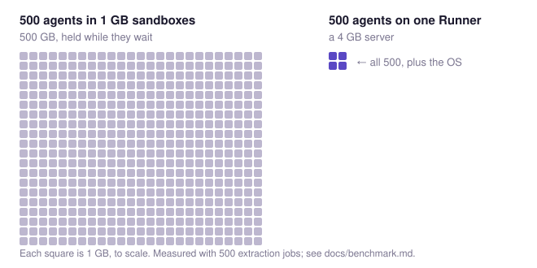

# agent-batch

> Map one agent over many inputs, on machines you own, and get back JSON that matches your schema

agent-batch runs real agents on unattended jobs. Give it one agent definition and a few hundred inputs, and each job comes back as JSON checked against your schema, or as a failure with its reason. The agent is [Pi](https://github.com/earendil-works/pi), working with real files and real shell commands in a sandbox of its own. The first five jobs run before the rest, and a Batch pauses itself when too many fail, so you can go to bed.

It does this without a sandbox per agent. An agent job is mostly an `await`: the loop sends a prompt, waits on the model, runs a command, waits again. You would not give every `fetch` in a Node program its own virtual machine, yet agents are often run in parallel by giving each one its own sandbox of 1 GB or more, paid for while the agent waits. In agent-batch the agent loops share a Runner process, and only their commands go into a per-job OS sandbox. Four hundred jobs in their own 1 GB sandboxes hold 400 GB of memory; on one Runner, for jobs that mostly wait on the model, they fit in a 4 GB server.

Try it on your machine with Docker and Node: `npx agent-batch stack start`, then [the first job](#an-everyday-chore-done-by-an-agent).

<picture>
  <source media="(prefers-color-scheme: dark)" srcset="docs/images/memory-dark.svg">
  
</picture>

Open source, MIT, TypeScript. Early: versions are 0.x.

## An everyday chore, done by an agent

The usual way to count the lines of a file:

```console
$ printf 'one\ntwo\nthree\n' > notes.txt
$ wc -l notes.txt
3 notes.txt
```

The same chore, done by an agent in a sandbox on your machine. The answer is known in advance, so you can check the run yourself. You need Docker, Node and `jq` (versions, and a step for Ubuntu 24.04, in [the host notes](#host-notes)).

```sh
npx agent-batch stack start
```

That runs a hub, a Runner and Postgres in the background, and on first run offers to sign you in to a model provider. The default is OpenRouter's free models, which still need an OpenRouter sign-in or key. Then the job:

```sh
cat > job.json <<'EOF'
{
  "customId": "quickstart-1",
  "agent": { "resultContract": { "schema": { "type": "integer" } } },
  "input": "Count the lines of inputs/notes.txt and submit the count.",
  "inputFiles": { "notes.txt": { "content": "one\ntwo\nthree\n" } }
}
EOF
ID=$(npx agent-batch jobs submit --input job.json | jq -er .id)
npx agent-batch jobs wait --id "$ID"             # prints the job when it ends; exits 1 unless it succeeded
npx agent-batch jobs get --id "$ID" | jq .result # 3
```

What happened: the agent found `notes.txt` in its Workspace's `inputs/` folder, counted, and could only finish by calling `submit_result`. The result was checked against the Result contract, the JSON Schema in the agent definition. Had it submitted `"3"` instead of `3`, the validation error would have gone back to the agent to fix; had it given up, the job would have failed with `noResult`. A job never succeeds with nothing in it. The schema checks the shape, not the facts: `4` is also an integer, so read some results.

If you did not see `3`: `npx agent-batch jobs events --id "$ID"` prints what the agent did, and `npx agent-batch stack logs --follow` prints the stack. Submit `job.json` a second time and you get the same job back, because the `customId` is the same. `npx agent-batch stack stop` keeps your data; `npx agent-batch stack delete` removes it and does not ask.

Now change the input: put your own file in `inputFiles`, change the schema to whatever you want back, give it a new `customId`, and submit. That is the whole programming model; everything below is doing it many times at once.

## Why 400 fit in 4 GB

A container or VM per agent costs memory and seconds of CPU before the agent does anything: about 75–80 MiB even for a bare container running a Runner, and whatever you provision for a hosted sandbox, commonly 1 GB or more. Then it sits there while the agent waits on the model. An agent loop that is mostly `await` needs a few MiB. So in a Runner, the loops (the agent is [Pi](https://github.com/earendil-works/pi)) run many to a process, and each job's shell commands and file access go into a lightweight per-job sandbox (Anthropic's [sandbox-runtime](https://github.com/anthropics/sandbox-runtime): bubblewrap on Linux, Seatbelt on macOS), with no network for job commands by default.

```text
one Runner process (Node, on your machine)
├─ job 1    agent loop · waiting on the model
├─ job 2    agent loop · waiting on the model
├─ job 3    agent loop · running `wc -l inputs/notes.txt` ──► its own OS sandbox, no network
├─ ...
└─ job 400  agent loop · waiting on the model
```

| Measured on one Hetzner CAX11, 2026-10-25/26                                          | One Runner                                                                                                                                                                                                                                                                                                                                         | One container per job            |
| ------------------------------------------------------------------------------------- | -------------------------------------------------------------------------------------------------------------------------------------------------------------------------------------------------------------------------------------------------------------------------------------------------------------------------------------------------- | -------------------------------- |
| Extraction jobs open at once (read a messy invoice, CV or ticket; submit JSON)        | **350–425**, 12–14× more                                                                                                                                                                                                                                                                                                                           | about 30, then the host thrashed |
| Memory per open job                                                                   | 6.5 MiB                                                                                                                                                                                                                                                                                                                                            | about 90 MiB                     |
| CPU per job, CPU-heavy jobs (data scripts over large CSVs, code fixes with test runs) | **1.45–4.9× less**; 1.45× for the heaviest, where the jobs' own work dominates                                                                                                                                                                                                                                                                     | baseline                         |
| Conditions                                                                            | Arm, 2 vCPU, 4 GB RAM, about €7 a month. The Runner from 0.2.0, with real commands in real sandboxes. Model responses replayed from real recordings: at 20× their recorded latency for the jobs held open, standing for a slow model; at their recorded timing for CPU. 425 needs systemd's `TasksMax` raised. Server cost only, not model tokens. | same server, same Runner image   |

One container too many hung the host for about 30 minutes instead of failing a job. These are particular workloads on one machine, not a capacity guarantee. Method and results: [docs/benchmark.md](docs/benchmark.md).

<!-- recording: a terminal, about 30 seconds, no narration, labelled "Hetzner CAX11, 2 vCPU, 4 GB". A Batch of a few hundred text jobs is added with the CLI; the 5 Canary jobs end first; then `jobs list --status running` and `--status succeeded` are re-run every few seconds and the counts move from running to succeeded; one `jobs get | jq .result` prints a validated JSON object. -->

A Runner runs 8 jobs at a time by default. That is the concurrency limit, and it is a setting:

```sh
RUNNER_MAX_JOBS=100 npx agent-batch stack start --env RUNNER_MAX_JOBS
```

`--env` replaces the list of forwarded variables, so name every one you forward, such as `--env RUNNER_MAX_JOBS --env OPENROUTER_API_KEY`.

## `inputs.map(agent)`: job postings

Keep the agent, change the input. A Batch is many jobs sharing one agent definition; your first job was already a Batch of one. Say you have job postings and want, for each, what it really requires and how senior it is.

The agent, once:

```sh
cat > agent.json <<'EOF'
{
  "agent": {
    "instructions": "Read the job posting in inputs/posting.txt. Submit the requirements it treats as mandatory, the ones it treats as optional, and the seniority it is really asking for, judged from the responsibilities rather than the title.",
    "resultContract": {
      "schema": {
        "type": "object",
        "required": ["mustHave", "niceToHave", "seniority"],
        "properties": {
          "mustHave": { "type": "array", "items": { "type": "string" } },
          "niceToHave": { "type": "array", "items": { "type": "string" } },
          "seniority": { "type": "string", "enum": ["junior", "mid", "senior", "lead"] }
        }
      }
    },
    "runTimeoutSeconds": 300,
    "modelBudgetUsd": 0.05
  }
}
EOF
BATCH=$(npx agent-batch batches create --input agent.json | jq -er .id)
```

Then one job per posting, each with its own text and custom ID, up to 100 per call:

```sh
cat > postings.json <<'EOF'
[
  { "customId": "posting-0001", "input": "Posting 0001.",
    "inputFiles": { "posting.txt": { "content": "Software Engineer II, Example Corp\nYou will own the billing service end to end and mentor two engineers. Required: 5+ years TypeScript, Postgres. Nice: Effect, Cloudflare Workers.\n" } } },
  { "customId": "posting-0002", "input": "Posting 0002.",
    "inputFiles": { "posting.txt": { "content": "Junior Developer, Example GmbH\nYou will fix bugs in our Node services with a senior engineer reviewing every change. Required: JavaScript. Nice: Docker.\n" } } }
]
EOF
jq --arg id "$BATCH" '{id: $id, jobs: .}' postings.json \
  | npx agent-batch batches add-jobs --input - | jq -r '.jobs[].job.id' > ids
for id in $(cat ids); do
  npx agent-batch jobs wait --id "$id" | jq -c 'if .status == "succeeded" then .result else {id, status} end'
done
```

Each line is one posting's result, already checked against the schema, or a failed job's ID and status. A run gave:

```json
{"mustHave":["5+ years of TypeScript experience","Postgres"],"seniority":"senior","niceToHave":["Effect","Cloudflare Workers"]}
{"mustHave":["JavaScript"],"seniority":"junior","niceToHave":["Docker"]}
```

The first title said II; the responsibilities said senior.

`--input <file>`, or `-` for stdin, gives any command its whole input as JSON; `npx agent-batch <command> --help` and the hub's reference at `/` list every field.

## Stop watching your agents

Two postings you can watch. Four hundred you count. With four hundred, this happens:

1. By default, the first 5 jobs run before the others. This is the Canary. If any fails, the Batch pauses before the rest start, so a prompt that breaks every job is caught after five, not four hundred.
2. After the Canary, if more than 10% of jobs fail, the Batch pauses. This is the failure breaker.
3. `batches resume --id "$BATCH"` carries on where it stopped; `batches pause`, `cancel` and `get` work the same way, as do single jobs, and ended jobs can be deleted.

The hub records every job's events (what the agent did), activity, usage in tokens and cost, and result. A Batch counts its jobs by status, and jobs can be listed by status, label, Batch and custom ID:

```sh
npx agent-batch batches get --id "$BATCH" | jq -c .jobCounts   # {"queued":0,"running":0,...,"succeeded":2,...}
npx agent-batch jobs list --batch-id "$BATCH" --status failed
npx agent-batch jobs list --batch-id "$BATCH" --status succeeded   # listed jobs carry no result: read one with jobs get
```

Jobs can be added continuously (`add-jobs`, `jobs submit`) and read continuously (`jobs wait`, `jobs list`). A job's journal is on disk, so a restarted Runner recovers its jobs where they stopped. A prompt that gives wrong but valid answers passes the Canary. Read some results.

## Read it before you run it

Underneath, it is a plain job queue whose worker happens to think: an HTTP API on Postgres (Node or Docker, or Cloudflare Workers with Postgres through Hyperdrive), and Runners that connect out to it. The repository is `chuse-ai/agent-batch`: TypeScript on Effect, oRPC, Hono and Zod, with Pi and sandbox-runtime inside. The CLI, the npm package `agent-batch`, only calls the hub's HTTP API.

So can anything else. Your hub serves an OpenAPI 3.1 document at `/spec.json` and a browsable reference at `/`:

```sh
eval "$(npx agent-batch stack env)"   # exports AGENT_BATCH_URL and AGENT_BATCH_API_KEY
curl -sS -H "x-api-key: $AGENT_BATCH_API_KEY" "$AGENT_BATCH_URL/spec.json" | jq '.paths | keys'
curl -sS -H "x-api-key: $AGENT_BATCH_API_KEY" "$AGENT_BATCH_URL/jobs?status=succeeded"
```

### Job commands never see your model key

Model-provider credentials live in the Runner, outside every job sandbox. The Runner calls the model; the job's commands run in bubblewrap or Seatbelt with no network, and the provider key is not in their environment. Ask an agent to look:

```sh
cat > look.json <<'EOF'
{
  "customId": "look-1",
  "agent": { "resultContract": { "schema": { "type": "object", "required": ["names", "networkWorks"],
    "properties": { "names": { "type": "array", "items": { "type": "string" } }, "networkWorks": { "type": "boolean" } } } } },
  "input": "Run `env` and submit the names of the environment variables you see, names only. Then run `node -e \"fetch('https://example.com').then(r => console.log(r.status))\"` and submit whether it printed a status."
}
EOF
ID=$(npx agent-batch jobs submit --input look.json | jq -er .id)
npx agent-batch jobs wait --id "$ID" | jq -c '.result | {networkWorks, keys: [.names[] | select(test("KEY|TOKEN|SECRET"))]}'
```

A run whose Runner held an OpenAI key printed `{"networkWorks":false,"keys":[]}`; the same `fetch` run in the Runner's own container printed `200`.

The model is per Runner. `stack start --provider anthropic --model claude-sonnet-5-5` picks any provider and model Pi supports; `stack login --provider P` adds a provider's sign-in (`--with-api-key` reads a key from stdin); `--env NAME` forwards a host variable, such as a provider key, to the Runner. For several models, run several Runners.

## When not to use agent-batch

- You want to talk to the agent. Jobs run unattended and end; there is no chat.
- You want one answer to one request, right now. Submitting and reading are separate steps, and there is no push or callback.
- The job needs the web, a PDF or a photo. Job commands have no network, and input files are inline text; paste text.
- People who must not see each other's work share the machine. The sandbox is around each job's commands; agent-batch is for one organization, not hostile multi-tenant use.
- Every job wants a different model. The model is per Runner; run a Runner per model.
- Your jobs must move between hosts. A job's journal and Workspace stay with the Runner that took it, and each data directory takes one Runner process.

Full list: [docs/release-scope.md](docs/release-scope.md).

## Host notes

agent-batch needs Docker Engine 29+ with Compose 5+, and Node 22.19+. On Ubuntu 24.04, run `sudo sysctl -w kernel.apparmor_restrict_unprivileged_userns=0` before `stack start`, so the sandboxes can start, and add a file in `/etc/sysctl.d` to keep it. Ubuntu 25.04 and later are not supported yet. Logins, status, logs and upgrading: [docs/deploy.md](docs/deploy.md).

## More than one machine

`stack start` is for one machine. For a hub that Runners on other machines connect to, the repository's [`compose.yaml`](compose.yaml) runs the hub, Postgres and a Runner from the published images, `ghcr.io/chuse-ai/agent-batch-hub` and `ghcr.io/chuse-ai/agent-batch-runner` (linux/amd64 and arm64). Today you create API keys there with `curl` against the hub, because the CLI cannot sign in yet. Steps: [docs/deploy.md](docs/deploy.md#several-machines-docker-compose).

## Working on agent-batch

Issues are welcome, including ones about this page. Outside pull requests are not accepted for now; [CONTRIBUTING.md](CONTRIBUTING.md) explains and has the development commands. `npx agent-batch --help` lists every command.

agent-batch is made by FluteBlade at chuse. MIT licence.
